# GoGaming

[](https://github.com/Daniel-goga-GIT/gogaming/actions/workflows/ci.yml)

Tienda online de periféricos gaming: ratones, teclados, alfombrillas, skates, auriculares/IEM y mangas.
Tiene catálogo con buscador, cesta, **pagos reales con Stripe Checkout** (modo test), reseñas, login con **2FA por email** o con **Google**, panel de administración y un **asistente con IA** que recomienda productos a partir del catálogo real.

**Stack:** Spring Boot 4 · Java 21 · MariaDB · Angular 20 · Tailwind CSS · Stripe · OpenRouter

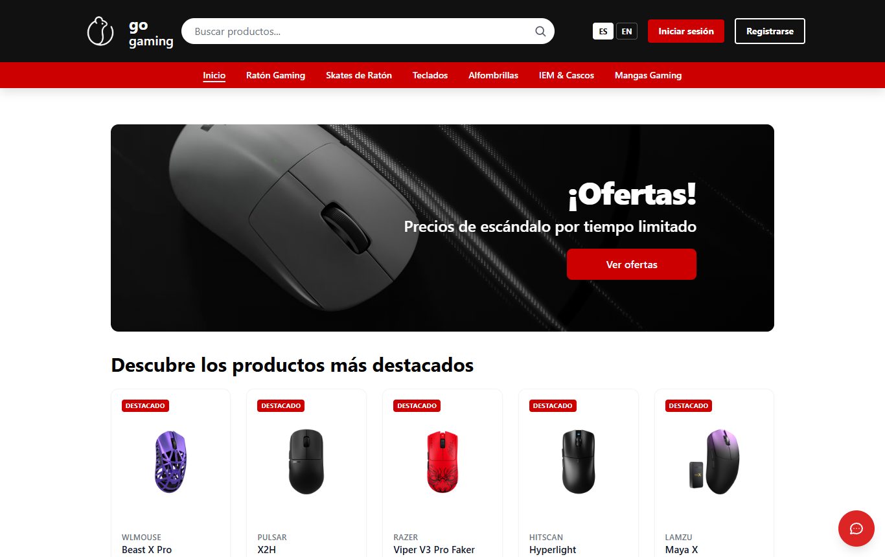

## Capturas

| Catálogo | Ficha de producto |
|---|---|
| 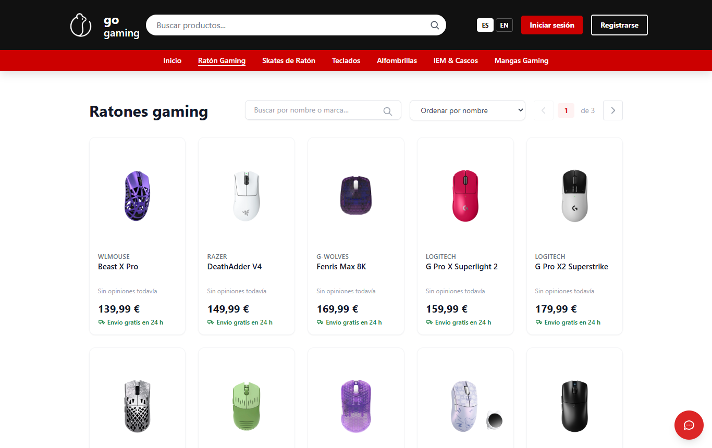 | 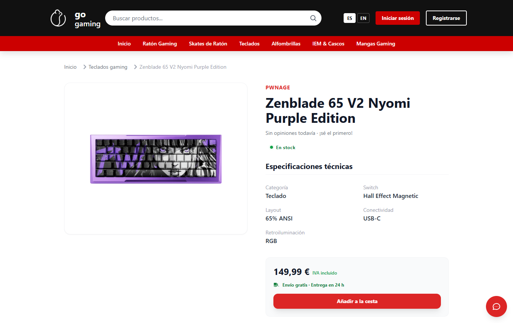 |
| **Buscador global** | **Cesta** |
| 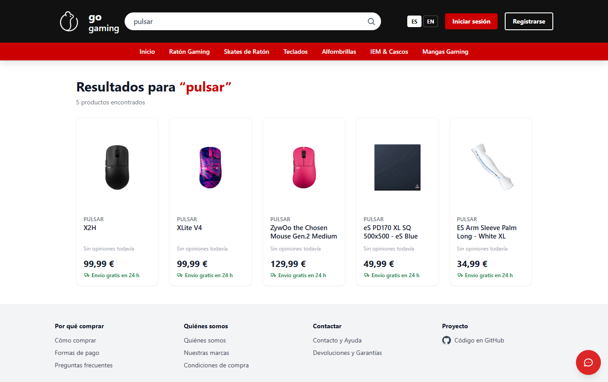 | 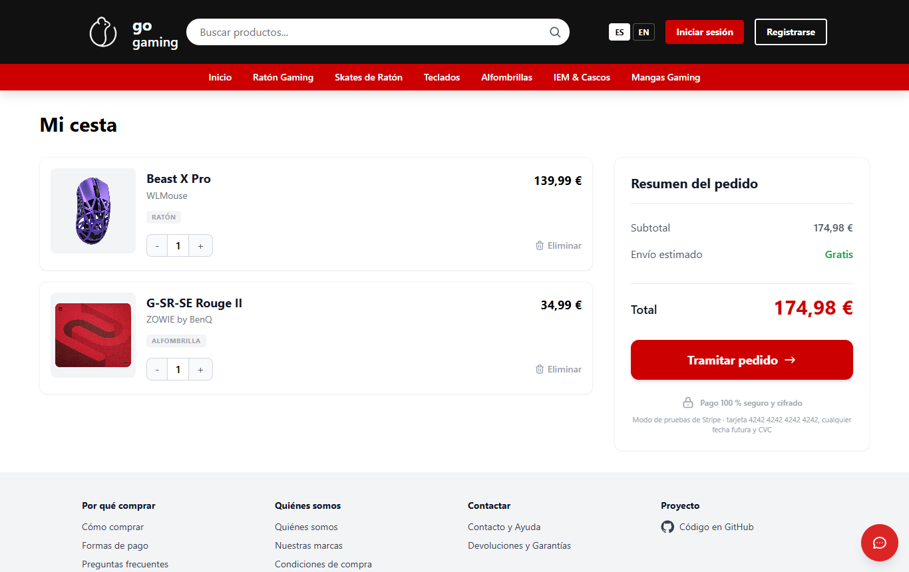 |
| **Pago completado (tras Stripe Checkout)** | **Asistente con IA** |
| 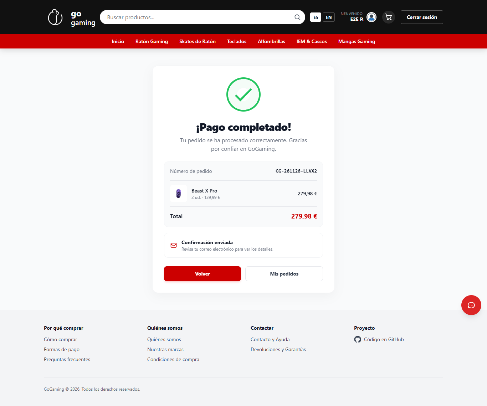 | 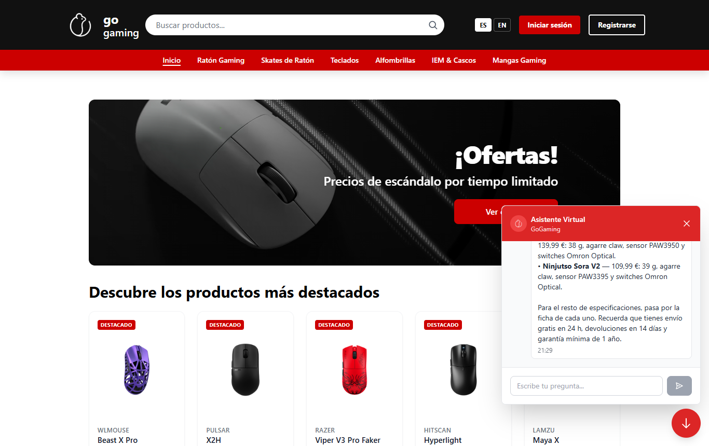 |
| **Panel de administración** | **Formulario generado por categoría** |
| 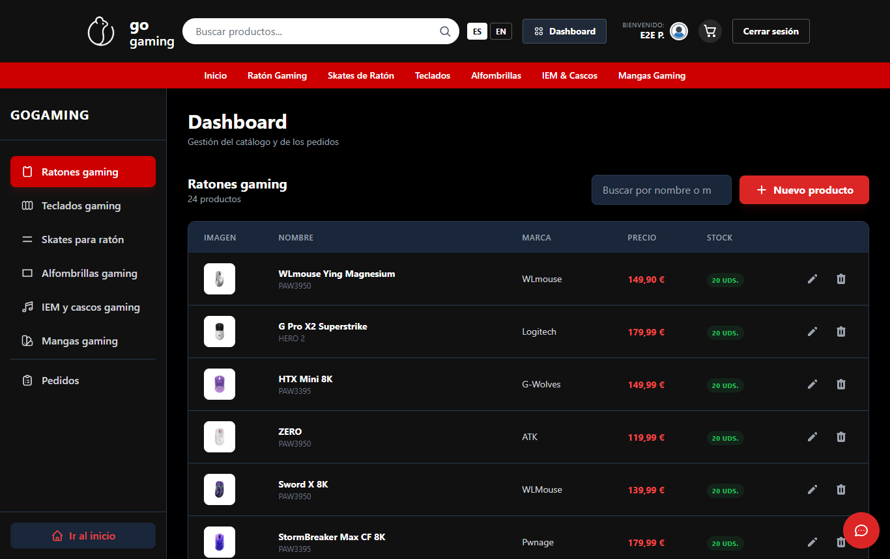 | 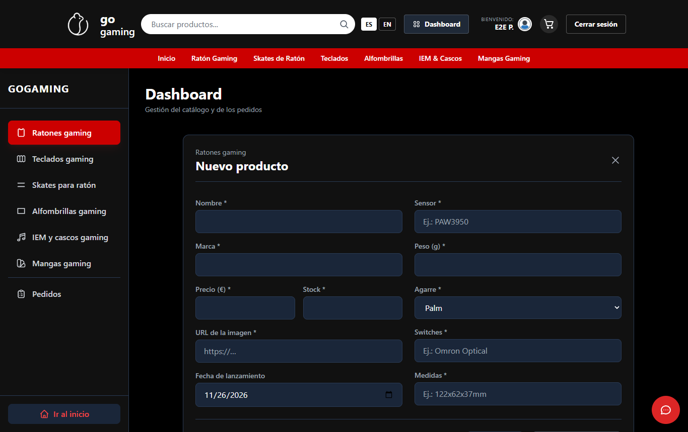 |

| Móvil | | API (Swagger) |
|---|---|---|
| 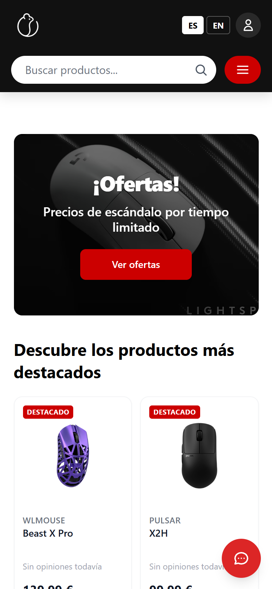 | 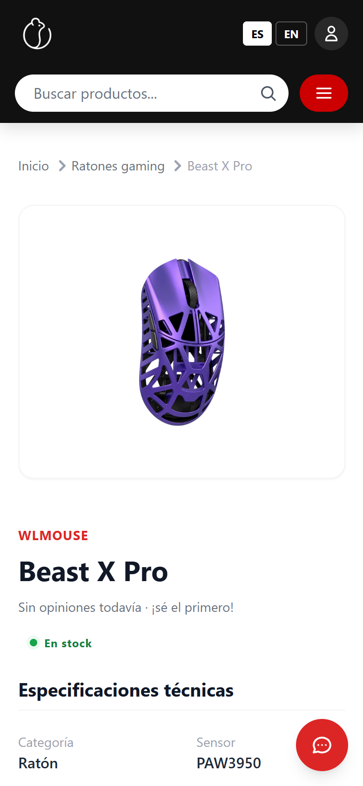 | 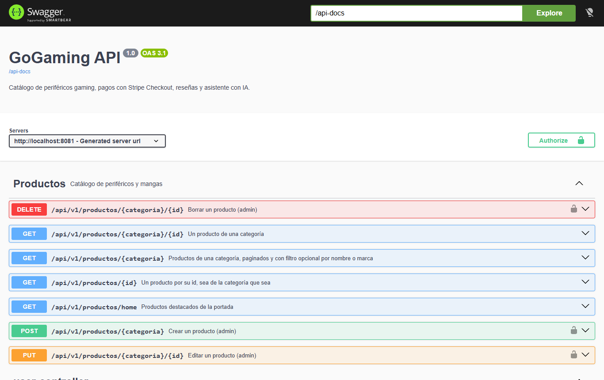 |

## Funcionalidades

- **Catálogo** público de 6 categorías, con paginación, orden, filtro por nombre o marca y buscador global. Las fichas generan su tabla de especificaciones según la categoría.
- **Cesta** guardada en el navegador, que respeta el stock.
- **Pago con Stripe Checkout.** El backend vuelve a validar la cesta contra la BD (precio y stock) y el pedido se crea solo cuando Stripe confirma el pago, por la vuelta del cliente o por el webhook. Es idempotente: un mismo pago nunca genera dos pedidos. Tras pagar llega un email de confirmación.
- **Cuentas:** registro con foto de perfil, login en dos pasos (contraseña + código de 6 cifras por email) o con Google, y perfil con pedidos y reseñas.
- **Reseñas** de 1 a 5 estrellas, una por usuario y producto. La media sale en las tarjetas y en las fichas.
- **Asistente con IA** (OpenRouter, modelos gratuitos con reintentos y alternativas). Recibe el catálogo real (precios, stock y especificaciones) y tiene prohibido inventar.
- **Panel de administración:** CRUD de productos de las 6 categorías con un único formulario generado a partir de la definición de cada una, y gestión del estado de los pedidos.
- **Bilingüe** (español/inglés). Un script comprueba que no falte ninguna traducción.

## Decisiones técnicas

- **Catálogo genérico.** Un solo `ProductoController`/`ProductoService` en el backend y un solo listado, ficha y formulario en el frontend sirven a las 6 categorías. Las tablas usan herencia JOINED. Añadir una categoría supone crear su entidad y su DTO, y añadir una entrada al enum `CategoriaProducto` y otra a `catalogo.ts`. Antes había seis copias de todo (unas 5.000 líneas menos).
- **Seguridad.**
  - JWT firmados con RS256. El token del primer paso (pendiente de 2FA) no da acceso a nada.
  - Límite de intentos de contraseña y de código 2FA. Los códigos se generan con `SecureRandom`.
  - Las imágenes subidas se validan por extensión y por *magic bytes*.
  - Validación de los datos en el servidor y `permitAll` limitado a `GET` del catálogo.
  - El token de Google llega en el fragmento de la URL, no en la query.
- **Pagos.** El precio cobrado se guarda en la metadata de la sesión de Stripe y el pedido se crea a partir de ahí. La columna `stripe_session_id` es única, para que el pedido no se duplique si la confirmación llega a la vez por el cliente y por el webhook.
- **Rendimiento.** El resumen de valoraciones de una página se pide con una sola consulta agrupada; antes eran 7 consultas por producto.

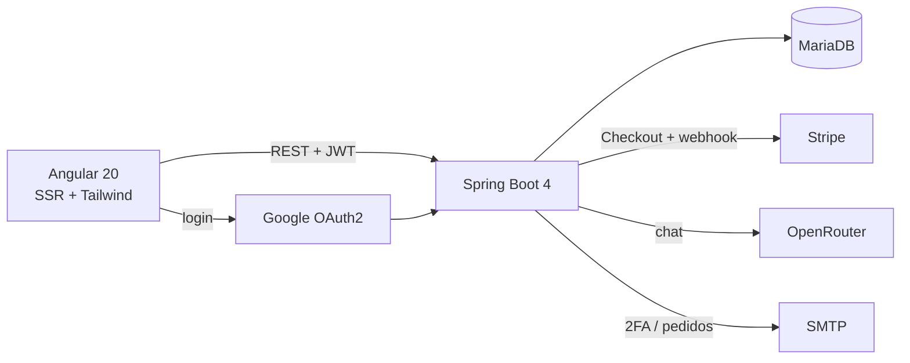

## Puesta en marcha (local)

Requisitos: Java 21, Node 22 o superior, Docker.

```bash
# 1. Base de datos
cd backend
cp .env.example .env          # y rellena los valores
docker compose up -d          # MariaDB 11.4 en 127.0.0.1:3306

# 2. Keystore para firmar los JWT (una sola vez)
mkdir -p storage/certs
keytool -genkeypair -alias jwt-keypair -keyalg RSA -keysize 2048 -storetype JKS \
  -keystore storage/certs/jwt.jks -storepass <JWT_KEYSTORE_PASSWORD> -validity 3650 -dname "CN=GoGaming"

# 3. Backend → http://localhost:8081  (Swagger: /swagger-ui-custom.html)
./mvnw spring-boot:run

# 4. Frontend → http://localhost:4200
cd ../frontend
npm install
npm start
```

Al arrancar, el backend crea el esquema y carga el catálogo (`schema.sql`, `data.sql`). No se crea ningún usuario. Para tener un administrador, regístrate en la web y ejecuta:

```sql
INSERT INTO user_roles (user_id, role_id)
SELECT idusuario, 1 FROM usuarios WHERE correo_electronico = 'tu@email.com';
```

**Pagos de prueba:** tarjeta `4242 4242 4242 4242`, cualquier fecha futura y cualquier CVC. Con 3D Secure: `4000 0027 6000 3184`.
Para probar el webhook en local: `stripe listen --forward-to localhost:8081/api/v1/payments/webhook` y copia el `whsec_…` en `STRIPE_WEBHOOK_SECRET`.

## Tests

```bash
cd backend && ./mvnw verify           # 34 unitarios + 9 de integración (MariaDB real con Testcontainers; necesita Docker)
cd frontend && npm run test:ci        # 31 tests (Karma + Chrome headless)
cd frontend && npm run i18n:check     # es/en completos y sin claves sin traducir
```

La integración continua (`.github/workflows/ci.yml`) ejecuta todo esto en cada push y pull request.

## Estructura

```
backend/   Spring Boot · com.gogaming
  controllers/  ProductoController (catálogo), Payments, Resena, Chat, Authentication, User
  services/     ProductoService + CategoriaProducto, StripePaymentService, ChatService, ...
  config/       SecurityConfig, JwtAuthenticationFilter, OAuth2, OpenAPI
frontend/  Angular 20 standalone
  core/         catalogo.ts (definición de categorías), servicios, interceptor, guards
  features/     productos/{listado,detalle}, cart, pago-completado, dashboard, login, twofactor, ...
  shared/       product-card, google-login-button, price pipe
docs/screenshots/
```

## Autor

Daniel González García — proyecto final del ciclo de Desarrollo de Aplicaciones Web (DAW), ampliado como proyecto de portfolio.
